# free-clac


使用 Flutter 开发的一款高级科学计算器，除常规表达式计算外，还内置二维平面函数绘图。
支持深色 / 浅色主题与五种界面语言（简体中文、繁體中文、English、日本語、Español）。

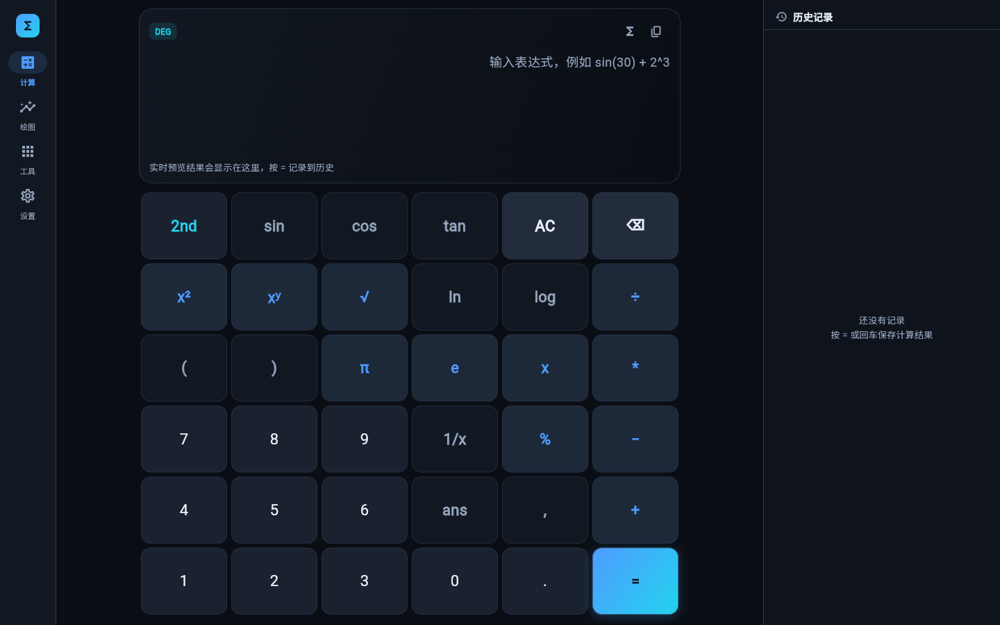
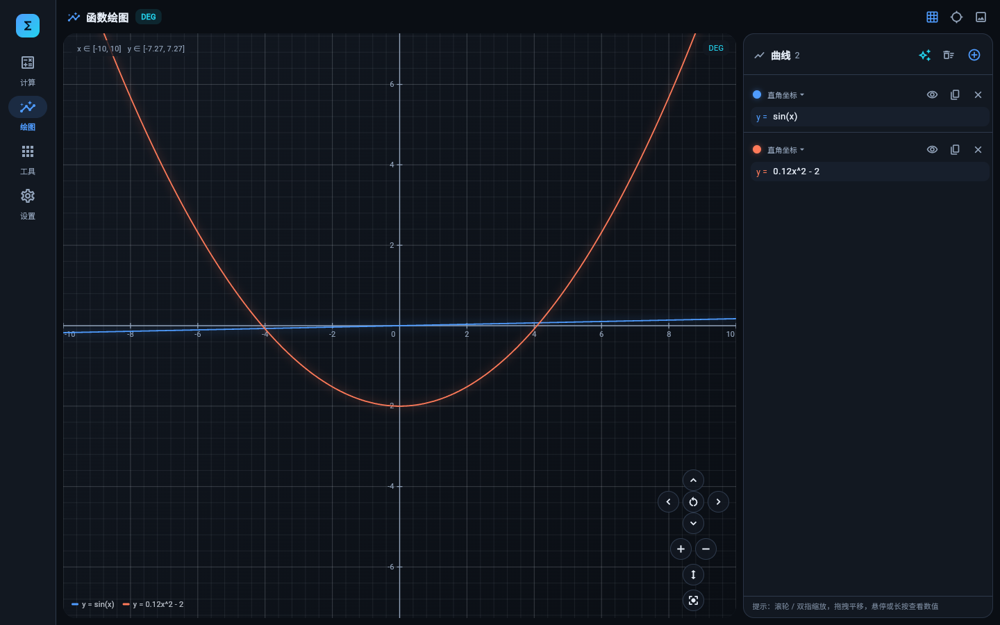
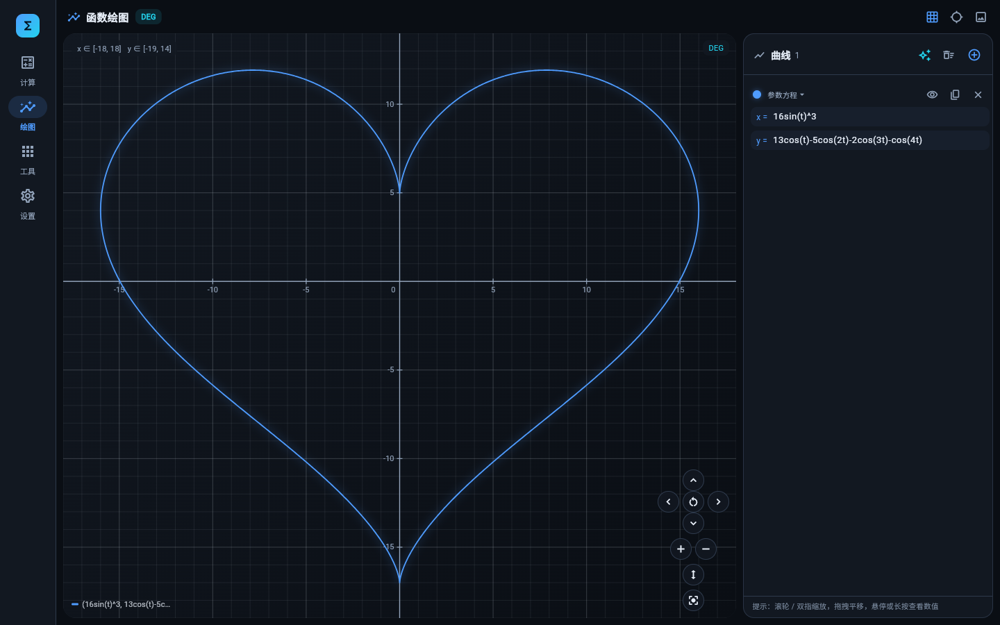
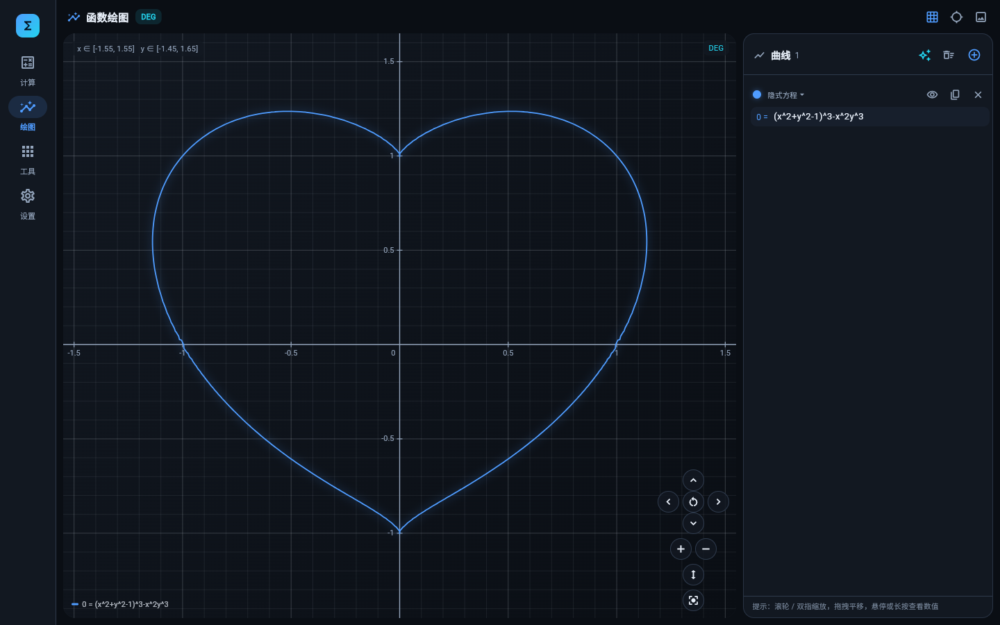

## 功能

### 计算

- 自研词法 / 语法分析器 + 递归下降解析，支持完整运算符优先级、右结合幂运算与隐式乘法（`2π`、`3sin(x)`、`(1+2)(3+4)`）
- 实时预览：输入表达式时即时显示结果；按 `=` 或回车写入历史
- 历史记录：点击回填表达式，支持 `ans` 连续计算
- 一键复制为 LaTeX：显示屏的复制菜单可复制 `结果`、`公式（LaTeX）` 或 `公式与结果`；历史记录每条也可复制 LaTeX，绘图页每条曲线同样支持（如 `\sin\left(30\right) = 0.5`、`y = x^{2}`、参数方程导出为 `cases` 环境）
- 角度单位一键切换 DEG / RAD（影响全部三角与反三角函数）
- 乘号按键显示为 `*`，粘贴 `×` 也会自动转换成 `*`
- Unicode 输入归一化：`× ÷ − π τ φ √ ∞`、全角括号、上标数字（`x²`）自动转换
- 常量：`π e τ φ ∞`
- 变量：`ans`（上次结果）、`mem`（存储值，支持 M+ / M− / MR / MC）

### 数学能力

| 类别 | 支持内容 |
| --- | --- |
| 三角 | `sin cos tan sec csc cot` 及反函数 `asin acos atan atan2` |
| 双曲 | `sinh cosh tanh asinh acosh atanh` |
| 指数对数 | `exp ln log lg log2`、任意幂 `x^y`、`√`、`cbrt`、`root(n,x)` |
| 取整 | `abs sign floor ceil round trunc frac`、取模 `mod` / `a % b` |
| 组合统计 | `fact`、`gamma`、`ncr`、`npr`、`gcd`、`lcm`、`min`、`max`、`avg`、`hypot` |
| 单位换算 | `deg`、`rad`、`sinc` |
| 随机 | `rand()`、`randint(a,b)` |
| 高级 | 求和 `sum(expr, i, a, b)`、连乘 `prod(...)` |
| 微积分 | 定积分 `integrate(f, x, a, b)`（自适应 Simpson）、数值求导 `diff(f, x, a)`（中心差分 + Richardson 外推） |

数值格式化会自动去除浮点噪声、按需切换科学计数法。

### 绘图

- 四种曲线类型：直角坐标 `y = f(x)`、极坐标 `r = f(t)`、参数方程 `(x(t), y(t))`、隐式方程 `f(x, y) = 0`
- 多条曲线同时绘制，独立配色、显隐、删除、类型切换
- 像素级自适应采样：按屏幕像素细分，间断点（如 `1/x`、`tan(x)`）自动断线
- 隐式方程用 marching squares 逐格求等值线，交点首尾相接成折线，鞍点按格心符号消歧；隐式曲线在追踪时显示该点的 `f(x, y)` 取值
- 交互：拖动平移、滚轮 / 触控板 / 双指缩放，悬停或长按追踪读数
- 移动视图：右下角十字方向键（或键盘 `← ↑ ↓ →`）按固定步长平移，`+` / `-` 缩放，`0` 重置视图
- 视图：网格与刻度自适应（1/2/2.5/5 × 10ⁿ）、纵向自适应、显示全部、重置
- 与计算器共享角度模式：极坐标与三角函数曲线随 DEG/RAD 切换重新采样
- 内置示例曲线：点面板右上角的 ✨ 图标一键载入心形函数、玫瑰线、李萨如曲线等，示例追加到当前画布（不清空已有曲线），详见下文
- 导出图片：点标题栏的图片按钮，可保存为 **PNG**（2 倍高清位图）、**WebP**（体积约为 PNG 的 1/10）或 **SVG**（矢量，可无限放大）
  - 保存位置与对话框里写的一致：Android 位图进相册 `Pictures/free-clac`、SVG 进 `Download/free-clac`（走 MediaStore，无需权限）；桌面端写入实际解析到的「图片」再退「下载」目录；Web 端交给浏览器下载
  - 导出按当前视口与画布尺寸重新渲染，含网格、坐标轴、刻度与曲线光晕

### 示例曲线

绘图页函数面板右上角的 ✨ 按钮会打开示例列表，点选即**追加**到当前曲线（不清空已有图形，重复点选不会叠加同一曲线），视口自动扩展为与原视口的并集，已有图形不会移出视野。
示例主要来自知乎《[绘制出令人怦然心动的7种心形函数](https://zhuanlan.zhihu.com/p/662309066)》：

| 示例 | 类型 | 表达式 |
| --- | --- | --- |
| 心形 | 参数方程 | `x = 16sin³t`，`y = 13cos t − 5cos 2t − 2cos 3t − cos 4t` |
| 心形 | 极坐标 | `r = 2 − 2sin t + sin t·√\|cos t\| / (sin t + 1.4)` |
| 心形（正切幂） | 极坐标 | `r = \|tan t\|^(1/\|tan t\|)` |
| 无限爱心 | 直角坐标 | `y = √\|sin x\| ± √\|cos x\|` |
| 填充爱心 | 直角坐标 | `y = \|x\|^(2/3) + (4/5)√(9/10 − x²)·sin(1000πx)` |
| 跳动爱心 | 极坐标 | `r = (4 + sin t)/√(1 − \|cos t\|·sin t)` |
| 心形 | 隐式方程 | `(x²+y²−1)³ − x²y³ = 0` |

此外还内置玫瑰线 `r = 4cos(3t)`、李萨如曲线 `x = 4sin(3t), y = 4sin(4t)` 等常见图形。

Web 端可直接深链到示例：`?page=plot&preset=0`（`preset` 为示例下标，从 0 开始）。

### 视图移动

绘图区右下角新增十字方向键，按画布宽高的 22% 平移视图；中间按钮重置视图。

| 操作 | 效果 |
| --- | --- |
| 拖动画布 / 方向键按钮 | 平移视图（拖动时鼠标为“抓手”光标） |
| 键盘 `← ↑ ↓ →` | 平移视图（画布获得焦点时，点一下画布即可） |
| 键盘 `+` / `-` | 放大 / 缩小 |
| 键盘 `0` | 重置视图 |
| 滚轮 / 双指 | 以光标为中心缩放 |

### 工具

导航栏的「工具」页以应用商店的形式列出内置小工具，点开即用，全部离线运行。
工具在「工具」tab 内部打开（tab 内嵌 `Navigator`），左侧导航栏 / 底部菜单始终保留，
返回键或页面左上角箭头回到应用列表。


#### BMI 计算

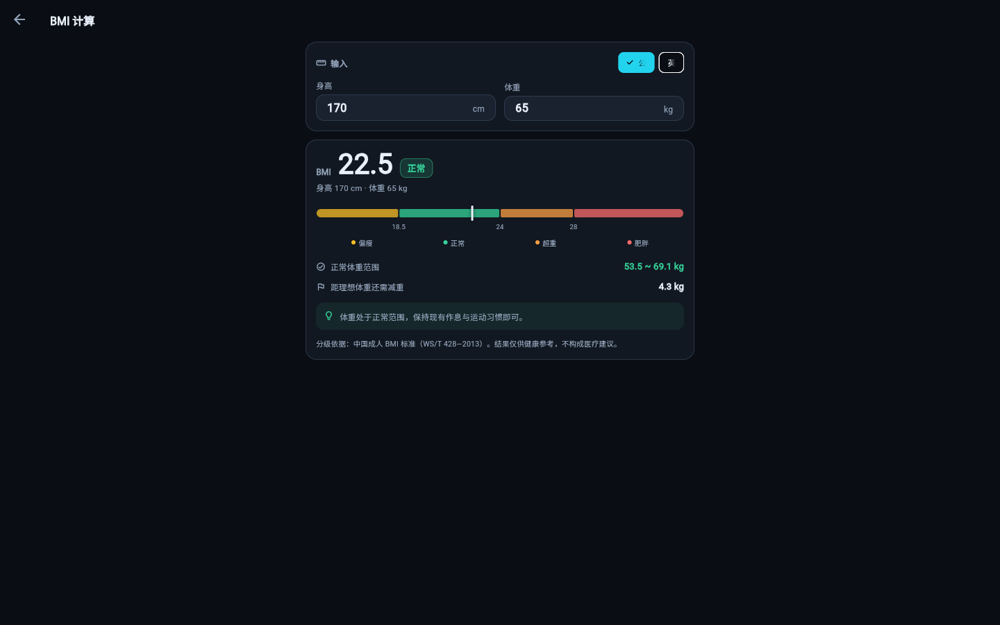

- 公制 / 英制一键切换，切换时按当前数值自动换算，BMI 结果不变
  - 公制：身高 `cm` + 体重 `kg`
  - 英制：身高单栏，右侧 `ft ▾` 菜单可切 `ft` / `in`（切换时数值自动换算）+ 体重 `lb`，
    身高单位与体重单位同一水平线
- 公制身高支持 `170` 与 `1.7` 两种写法；输入即算，无需点按钮
- 分级采用中国成人标准（WS/T 428—2013）：偏瘦 < 18.5、正常 18.5–24、超重 24–28、肥胖 ≥ 28
- 数值条按 14–34 的刻度分四段标出当前位置，并反推该身高对应的正常体重区间与差距（单位随公制 / 英制切换）

#### 复利计算

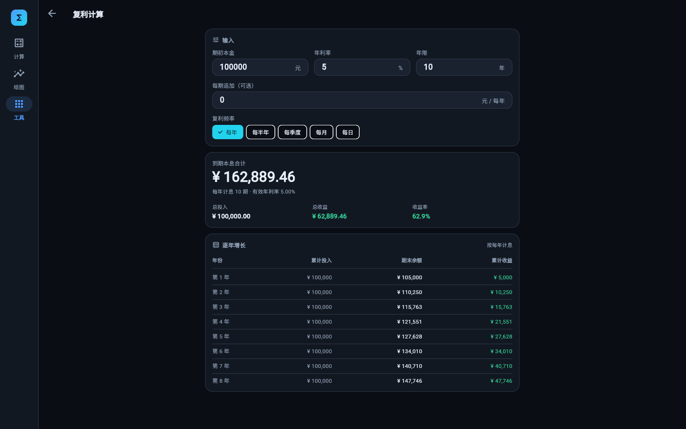

- 期初本金 / 年利率 / 年限三个输入框按 2 : 1 : 1 排一行（本金占两份宽），
  手机上自动折成「本金一行 + 利率 / 年限一行」
- 支持任意复利频率（每年 / 每半年 / 每季度 / 每月 / 每日）与每期定期追加
- 输出到期本息合计、总投入、总收益、收益率、有效年利率与逐年增长表
- 公式：`FV = P·(1 + r/m)^(m·t) + PMT·((1 + r/m)^(m·t) − 1) / (r/m)`，其中 `m` 为每年计息次数、`PMT` 为每期追加

#### 长度换算

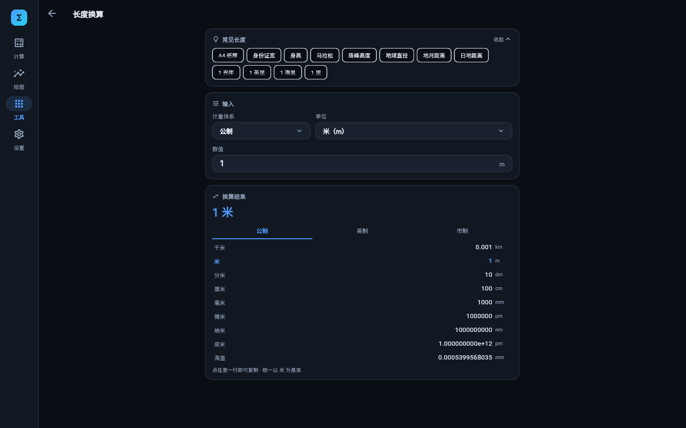

- 公制 / 英制 / 市制共 25 个单位互转，输入数值即算，点结果行即可复制
  - 公制：千米 / 米 / 分米 / 厘米 / 毫米 / 微米 / 纳米 / 皮米 / 海里
  - 英制：英寸 / 英尺 / 码 / 英里 / 英寻 / 链 / 化朗
  - 市制：里 / 引 / 丈 / 尺 / 寸 / 分 / 厘 / 毫 / 丝
- 数值上方两个下拉框选「计量体系」和「单位」，换体系时自动落到该体系第一个单位
- 换算结果按公制 / 英制 / 市制分成三个 tab，tab 跟输入单位联动；当前单位高亮，一屏看全同体系单位
- 顶部「常见长度」一键代入参照物：A4 纸厚、身份证宽、身高、马拉松、珠峰、地球直径、
  地月距离、日地距离、1 光年、1 英里 / 海里 / 里；点标题行可折叠隐藏，让输入区顶到最上面
- 口径：全部以米为基准，折算系数用分数精确保存（如 `1 英尺 = 3048/10000 米`、
  `1 尺 = 1/3 米`），连续换算不累积浮点误差；海里按 1852 米计

#### 面积换算

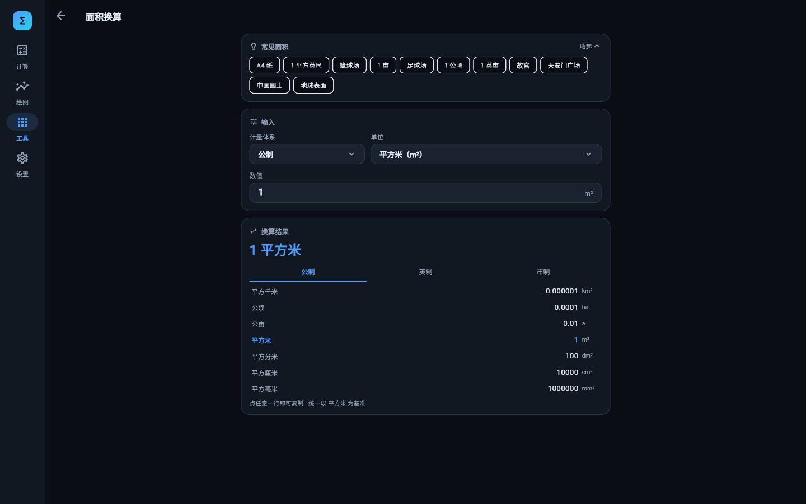

- 公制 / 英制 / 市制共 19 个单位互转，界面与长度换算一致：下拉框选体系与单位、结果分三个 tab、点行复制
  - 公制：平方千米 / 公顷 / 公亩 / 平方米 / 平方分米 / 平方厘米 / 平方毫米
  - 英制：平方英里 / 英亩 / 平方码 / 平方英尺 / 平方英寸
  - 市制：平方里 / 顷 / 亩 / 分 / 厘 / 平方丈 / 平方尺
- 「常见面积」参照物：A4 纸、篮球场、1 亩、足球场、1 公顷、1 英亩、故宫、天安门广场、
  中国国土面积、地球表面积
- 口径：以平方米为基准，`1 亩 = 2000/3 平方米`、`1 英亩 = 40468564224/10000000 平方米`、
  `1 平方英尺 = 9290304/100000000 平方米`（= 144 平方英寸），系数全部用分数精确保存

#### 重量换算

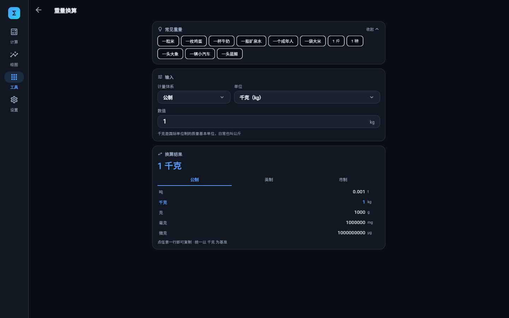

- 公制 / 英制 / 市制共 17 个单位互转
  - 公制：吨 / 千克 / 克 / 毫克 / 微克
  - 英制：长吨 / 短吨 / 磅 / 盎司 / 英石 / 格令
  - 市制：担 / 斤 / 两 / 钱 / 分 / 厘（按 1 斤 = 10 两 = 500 克）
- 「常见重量」参照物：一粒米、一枚鸡蛋、一杯牛奶、一瓶矿泉水、一个成年人、一袋大米、
  1 斤、1 磅、一头大象、一辆小汽车、一头蓝鲸
- 口径：以千克为基准，`1 磅 = 45359237/100000000 千克`、`1 长吨 = 2240 磅`、
  `1 短吨 = 2000 磅`、`1 市斤 = 1/2 千克`

#### 容量换算

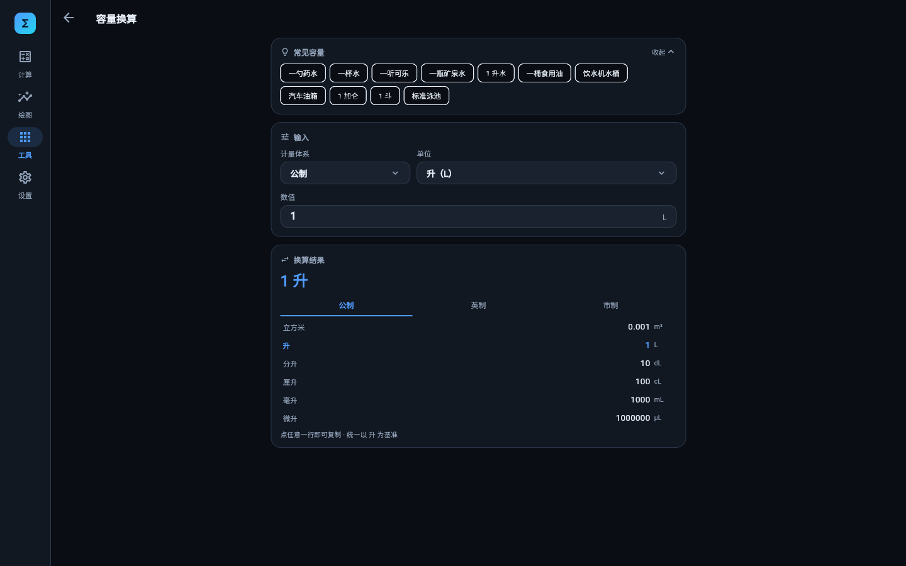

- 公制 / 英制 / 市制共 17 个单位互转
  - 公制：立方米 / 升 / 分升 / 厘升 / 毫升 / 微升
  - 英制：加仑 / 夸脱 / 品脱 / 液量盎司 / 蒲式耳（英制，`1 加仑 = 4.54609 升`）
  - 市制：石 / 斗 / 升 / 合 / 勺 / 撮
- 「常见容量」参照物：一勺药水、一杯水、一听可乐、一瓶矿泉水、1 升、一桶油、饮水机水桶、
  汽车油箱、1 加仑、1 斗、标准泳池
- 口径：以升为基准，英制 `1 加仑 = 454609/100000 升`、`1 蒲式耳 = 8 加仑`；
  市制 `1 石 = 10 斗 = 100 升`

#### 温度换算

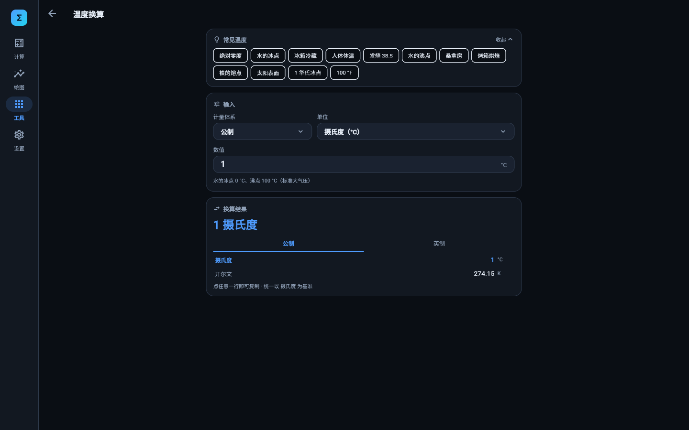

- 摄氏度 / 华氏度 / 开尔文 / 兰氏度互转；温度只有公制（摄氏 / 开尔文）与英制（华氏 / 兰氏）
  两套体系，所以只有两个 tab
- 温度是**仿射换算**（有零点偏移），不能只乘系数：模型里给单位加了 `baseOffset`，
  `摄氏 = 华氏 × 5/9 − 160/9`、`摄氏 = 开尔文 − 273.15`，`0 °C = 32 °F = 273.15 K` 精确成立
- 「常见温度」参照物：绝对零度、水的冰点、冰箱冷藏、人体体温、发烧 38.5、水的沸点、
  桑拿房、烤箱烘焙、铁的熔点、太阳表面、1 华氏冰点、100 °F

#### 速度换算

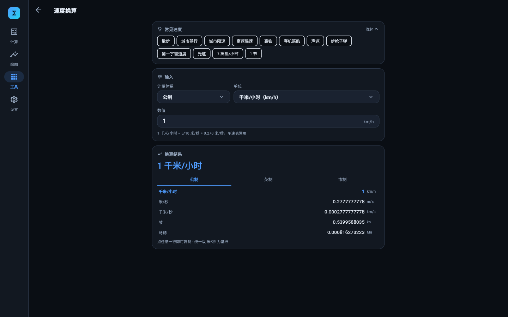

- 公制 / 英制 / 市制共 11 个单位互转
  - 公制：千米/小时 / 米/秒 / 千米/秒 / 节 / 马赫
  - 英制：英里/小时 / 英尺/秒 / 英里/分
  - 市制：里/小时 / 丈/秒 / 尺/秒
- 「常见速度」参照物：散步、城市骑行、城市限速、高速限速、高铁、客机巡航、声速、
  步枪子弹、第一宇宙速度、光速、1 英里/小时、1 节
- 口径：以米/秒为基准，`1 千米/小时 = 5/18 米/秒`、`1 英里/小时 = 0.44704 米/秒`、
  `1 节 = 1852/3600 米/秒`；马赫按 15 °C 海平面声速 340.3 米/秒计（随温度变化）

#### 利率计算

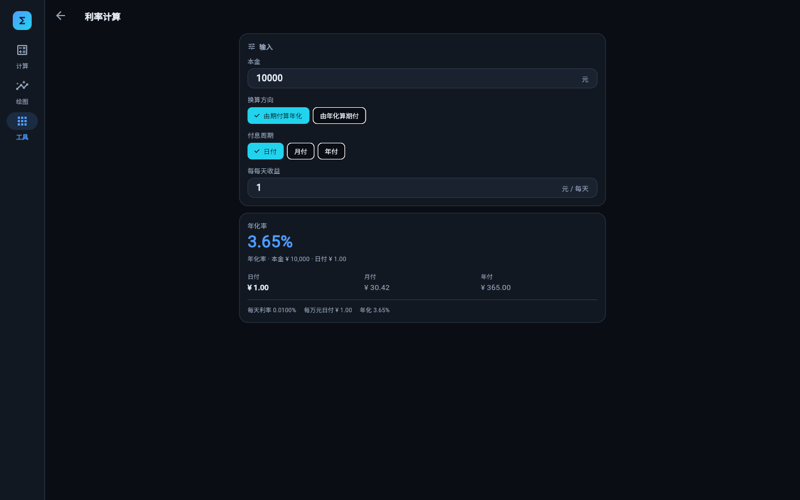

- 双向换算，一个页面搞定：
  - **由期付算年化**：输入本金 + 日付 / 月付 / 年付金额，反推年化率
  - **由年化算期付**：输入本金 + 年化率，算出日付 / 月付 / 年付三档收益
- 切换方向或周期时按当前结果自动换算，年化率保持不变
- 顺带给出当期利率、万份收益（每万元每个周期的收益）与三档收益对比
- 口径：单利年化，日付按 365 天、月付按 12 个月，`年化率 = 每期收益 × 每年期数 ÷ 本金`

#### 贷款计算器

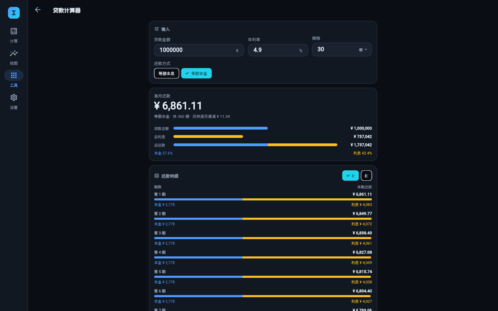

- 支持等额本息与等额本金两种还款方式，输入金额、年利率、期限（年 / 月可切换）即算
- 首屏给出月供（等额本金为首月，并标出逐月递减额）、贷款总额、总利息与总还款
- 汇总区用「贷款总额 / 总利息 / 总还款」三条对比条，条长按金额占「总还款」的比例缩放
  （不是三条等长的百分比条），总还款那条再拆成**蓝色本金 + 黄色利息**，
  一眼看出「总还款里有多少是本息、有多少是利息」；每期明细里同样有这条双色条
- 等额本金的明细条按当期还款额缩放成**倒梯形**：首期 100%、末期 60%，
  中间按金额线性插值（等额本息每期相等，故保持满长）
- 明细可按月 / 按年汇总，长期贷款不必翻 360 行
- 公式：等额本息 `M = P·i·(1+i)^n / ((1+i)^n − 1)`，等额本金每期本金 `P/n` + 当期利息 `i·余额`，
  其中 `i` 为月利率、`n` 为月数；最后一期会把浮点误差抹平，保证本金正好还清

#### 个人所得税

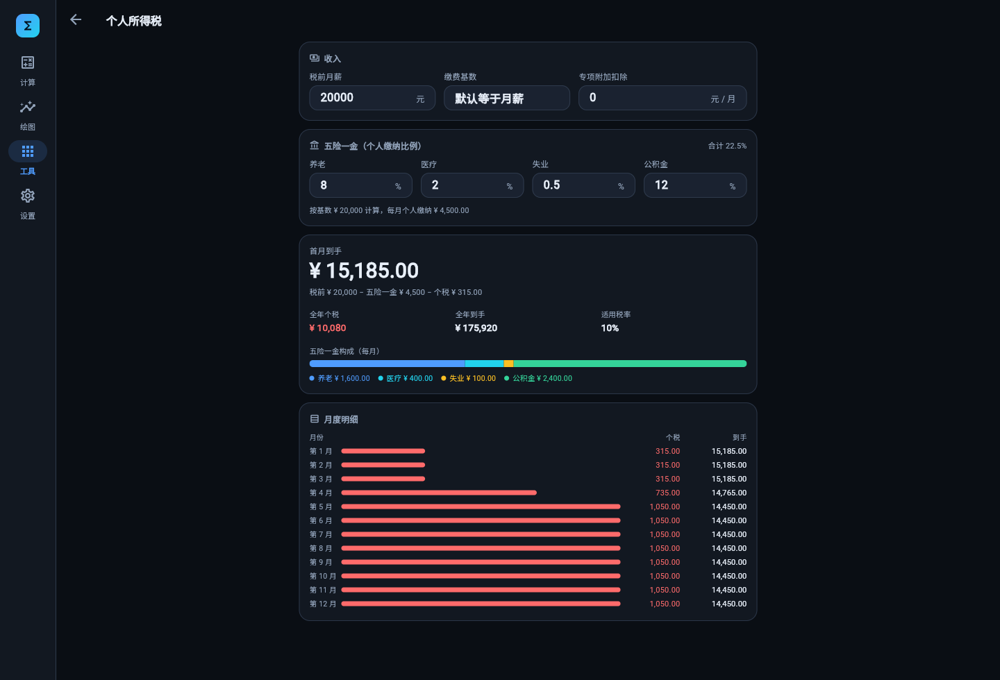

- 输入税前月薪、缴费基数（留空按税前月薪算）与专项附加扣除，自动算五险一金、个税与到手工资
- 五险一金按**比例**填写：养老 8% / 医疗 2% / 失业 0.5% / 公积金 12% 为默认值，四项都可改，
  卡头实时显示比例合计；缴费基数与月薪不同（按当地社保上下限）时可单独填
- 采用**累计预扣预缴法**：每月按截至当月的累计应纳税所得额查年度税率表，再减去已预缴税额，
  所以月薪固定时跨档的月份个税会跳升，逐月明细直接把这一步列出来
- 结果区：首月到手、全年个税、全年到手、适用边际税率，以及五险一金四段构成条（养老 / 医疗 / 失业 / 公积金）
- 口径：起征点每月 5000 元，七级超额累进税率 3% / 10% / 20% / 25% / 30% / 35% / 45%；
  应纳税所得额 = 月薪 − 五险一金个人部分 − 5000 − 专项附加扣除

#### 养老金计算器

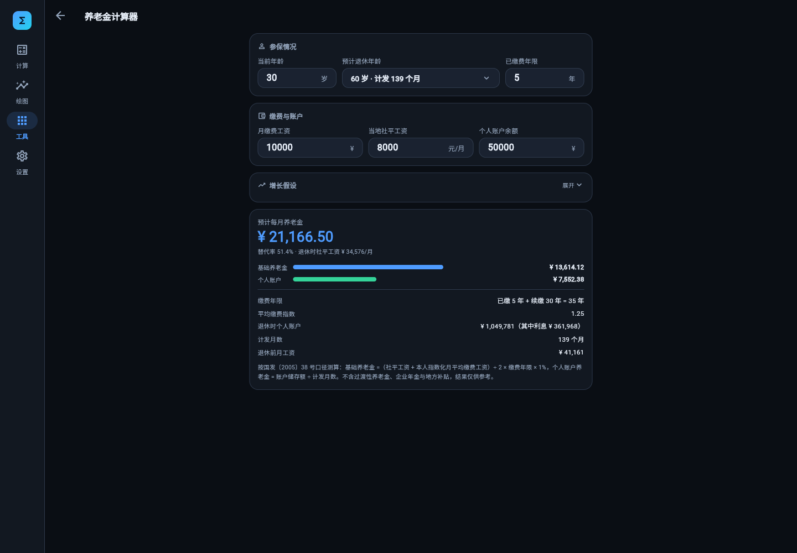

- 输入当前年龄、已缴费年限、月缴费工资、当地社平工资与个人账户余额，算出退休后每月能领多少
- 结果拆成**基础养老金**与**个人账户养老金**两条对比条，并给出替代率、平均缴费指数、
  退休时账户储存额（含利息）、计发月数
- 「增长假设」可折叠：社平工资年增长率、个人账户记账利率（缴费基数随社平同步增长）
- 口径按国发〔2005〕38 号：
  - 基础养老金 =（退休时社平工资 + 本人指数化月平均缴费工资）÷ 2 × 缴费年限 × 1%
  - 个人账户养老金 = 退休时账户储存额 ÷ 计发月数（60 岁 139、55 岁 170、50 岁 195）
  - 个人账户按月复利滚动，每月记入缴费基数的 8%
  - 不含过渡性养老金（1996 年前参加工作的「中人」）、企业年金与地方性补贴，结果仅供参考

#### 退休年龄计算器

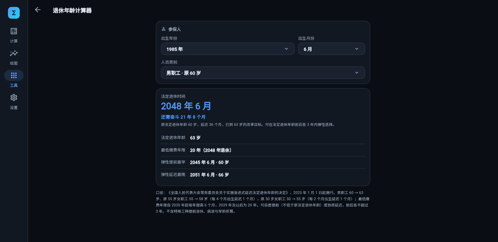

- 只需出生年月与人员类别（男职工 / 法定退休年龄 55 岁的女职工 / 50 岁的女职工），
  立刻算出**哪年哪月退休**、改革后的法定退休年龄、延迟了几个月、最低缴费年限与弹性区间
- 退休时间下方还有一行**「还需奋斗 X 年 Y 个月」**，按当前年月到退休年月的差算，
  已经到或过了退休年月的显示「已达到法定退休年龄」
- 出生年份、月份与类别都是下拉框，换一个档位结果实时重算；跨档的中间情形也能算
  （如 1965 年 3 月出生的男职工 → 60 岁 1 个月，2025 年 4 月退休）
- 口径按 2024-09-13《全国人民代表大会常务委员会关于实施渐进式延迟法定退休年龄的决定》：
  - 男职工 60 → 63 岁，原 55 岁女职工 55 → 58 岁，每 4 个月出生延迟 1 个月
  - 原 50 岁女职工 50 → 55 岁，每 2 个月出生延迟 1 个月
  - 出生早于改革区间（男 1965 年前、女 1970 / 1975 年前）不受影响，延迟月数为 0
  - 最低缴费年限：2029 年前 15 年，2030 年起每年提高 6 个月，2039 年及以后 20 年
  - 弹性退休：可自愿提前（不低于原法定退休年龄）或协商延迟，前后各不超过 3 年
  - 不含特殊工种提前退休、病退与军龄折算，结果仅供参考

Web 端可深链：`?page=tools` 打开工具页（`?page=settings` 打开设置页），`?page=tools&tool=bmi`（或 `compound`、`distance`、`area`、`weight`、`volume`、`temperature`、`speed`、`interest`、`loan`、`pension`、`retirement`、`tax`）直接打开某个工具；
`?page=tools&tool=loan&method=equalPrincipal` 还能直接停在等额本金，看明细的倒梯形。

## 设置与多语言

导航栏第四项「设置」里可以切换外观与界面语言，选择立刻生效并记在本机
（Web 用 `localStorage`，Windows / Android 写入用户配置目录的 `free-clac/settings.json`）。

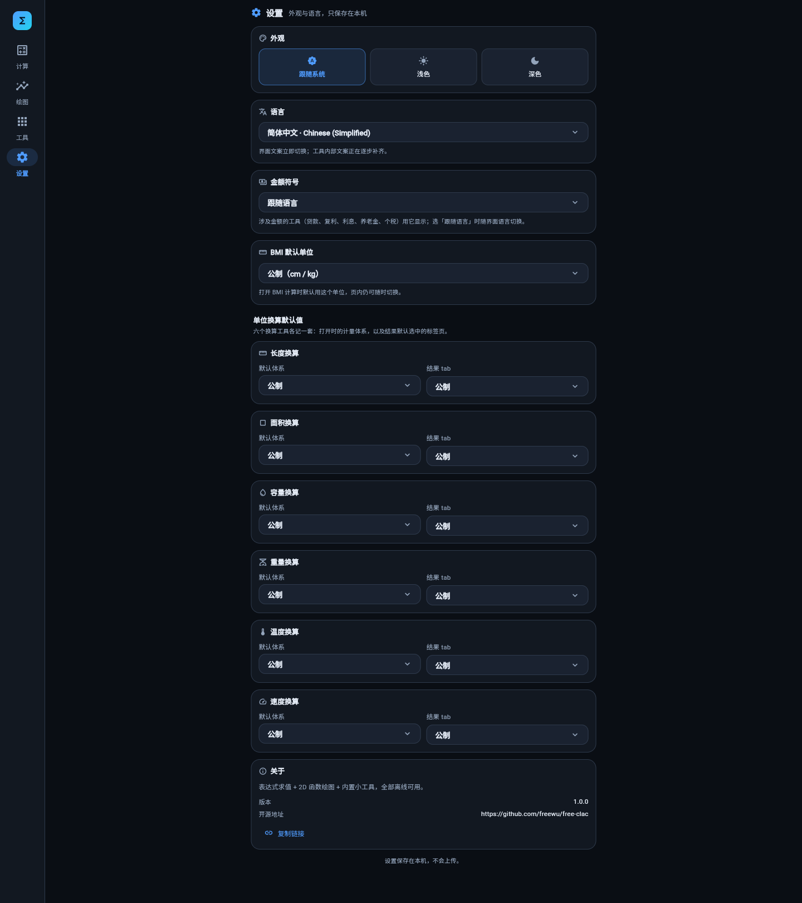

- **外观**：跟随系统 / 浅色 / 深色。深色与浅色各有一套完整配色
  （`lib/theme/app_theme.dart` 的 `kDarkPalette` / `kLightPalette`），
  不只是换背景色，卡片、描边、曲线调色板、按键渐变都跟着换
- **语言**：下拉框切换简体中文、繁體中文、English、日本語、Español；首次启动跟随系统语言
  （系统语言不在支持列表里时用英文），之后以设置里选的为准。工具卡片名称、卖点、说明
  与工具内文案都随语言切换
- **养老金计算器、退休年龄计算器与个人所得税只在简体 / 繁体中文界面出现**：三者按中国社保、
  退休与税法口径计算，换成英 / 日 / 西语时工具页只剩另外 10 个工具，
  深链 `?tool=pension` / `?tool=retirement` / `?tool=tax` 也不会打开
- **BMI 默认单位**：公制（cm / kg）或英制（ft·in / lb），默认公制；打开 BMI 计算时按它决定初始单位，
  初始数值也一并换算（170 cm ≈ 5.58 ft / 143.3 lb），页内仍可随时切换
- **单位换算默认值**：长度 / 面积 / 容量 / 重量 / 温度 / 速度六个换算工具各有一张设置卡片，
  各记一套「默认计量体系」与「结果默认 tab」，打开时按存档选中（温度、速度没有市制，
  选项只有公制 / 英制）；改动长度换算不会影响面积换算
- **关于**：版本号与仓库地址，一键复制链接

浅色模式下的计算器（按键、显示屏、绘图网格都已跟着变浅）：

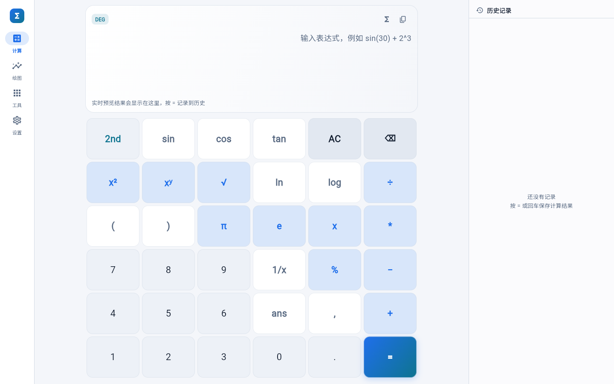

Web 端可深链：`?page=settings` 直接打开设置页，`?page=plot` / `?page=tools` 同理；
`?theme=light` / `?theme=dark` 用指定配色启动，`?lang=zh-Hant`（或 `zh-Hans` / `en` / `ja` / `es`）
用指定语言启动——两者都只对当前这次打开生效，不会改掉本机存的偏好（截图与分享链接用）。

同一批页面在英文与繁体中文下的样子：

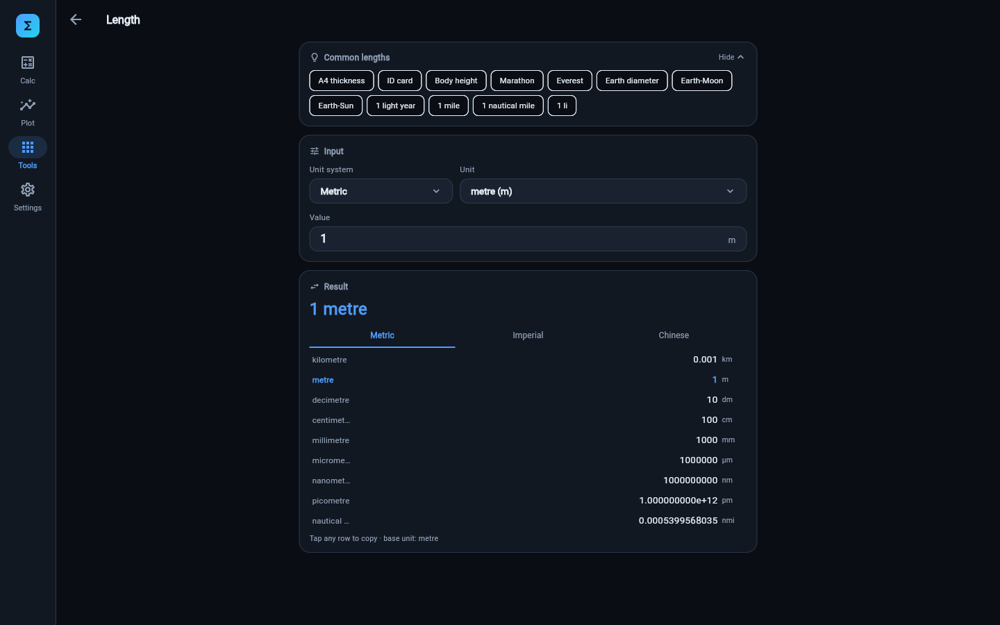
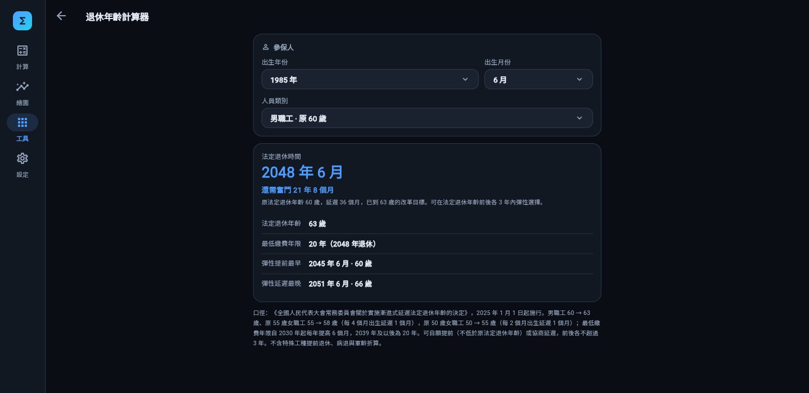

### 多语言的组织方式

- **应用级文案**在 `lib/l10n/`：`AppStrings` 是抽象类，五种语言各一个实现，
  用 `t.xxx` 取当前语言文案（`t` 依赖全局当前语言，切换后整棵树重建）
- **工具语言包**和逻辑、界面放在同一个目录，如 `lib/ui/tools/bmi/bmi_lang.dart`：
  `const Map<AppLanguage, ToolText> kBmiLang`，每个语言三项——名称、卖点、说明。
  `ToolInfo` 只存这份 map，`tool.name` 等 getter 按当前语言取，缺翻译回落简体中文
- 新增工具时要一并补 `<tool>_lang.dart`（五种语言），测试会检查语言包齐全、
  文案非空、工具 id 唯一
- **工具页内部文案**再各放一份 `<tool>_strings.dart`：一个 `class <Tool>Strings`
  用 `required` 具名字段列出全部文案，配合 `const Map<AppLanguage, <Tool>Strings>`
  与 `<Tool>Strings get <tool>Strings`（`required` 保证五种语言不缺项、漏写直接编译报错）。
  带参数的话术一律写成 `{0}` / `{1}` 模板，用 `fill()` 填充，避免在代码里拼句子
- 数据层的中文枚举名（还款方式、计息频率、付息周期、BMI 分级…）留在枚举里，
  页面上改为调 `<tool>Strings` 的 `methodLabel()` / `frequencyLabel()` 等方法
- 六个换算工具共用 `lib/ui/tools/widgets/unit_convert_strings.dart`，
  体系名称统一走 `measureSystemLabel()`
- **换算数据层也带语言**：`MeasureUnit.names` / `MeasureSample.names` 存 en / ja / es，
  `labelIn(language)` 取不到就回落简体中文（`zhHant` 与 `zhHans` 都用原文）；
  单位说明 `MeasureUnit.notes` 只翻了英文，`noteIn()` 对中文回落原文、对其他语言用英文
- 已接入：BMI、长度 / 面积 / 容量 / 重量 / 温度 / 速度、复利、利率换算、贷款
- **养老金 / 个税 / 退休年龄**按中国政策设计，`ToolInfo.availableIn` 只放简繁中文，
  两份文案都在 `<tool>_strings.dart` 里（`kPensionStrings` / `kTaxStrings` /
  `kRetirementStrings` 只含 `zhHans` 与 `zhHant` 两项，缺项时 `toolText` 回落简体）

## 应用图标

`logo.png`（256×256，透明底）是唯一来源，改图后执行一次即可同步所有平台：

```bash
just icons         # 由 logo.png 生成全部图标
just icons-check   # 只校验文件是否齐全（CI 可用）
```

生成的内容：

| 平台 | 文件 |
| --- | --- |
| Web | `web/favicon.png`、`web/icons/Icon-192/512.png`、`web/icons/Icon-maskable-192/512.png` |
| Windows | `windows/runner/resources/app_icon.ico`（16–256 七种尺寸，任务栏 / 资源管理器） |
| Android | `mipmap-*/ic_launcher.png`、`ic_launcher_round.png`，以及自适应图标 `ic_launcher_foreground.png` + `mipmap-anydpi-v26/ic_launcher.xml` |

Maskable / 自适应图标需要满幅，脚本会垫一层深色底（`#0B0F14`，与深色主题一致）并让图形占 72% 安全区；普通图标保留 logo 的透明背景。

logo 自带多少留白都不影响图标大小：脚本先按不透明像素裁掉四周留白（`trim_transparent`），再按统一比例补回（`LOGO_FILL = 0.92`，图形占画布 92%），最后缩放到各平台尺寸。`just check` 里的 `tool-check` 会跑 `tool/generate_icons.py --selftest`，用内存里的合成图验证裁边、补白、安全区与平台尺寸表。
项目暂无 iOS / macOS 目录，如需新增平台，脚本里加一段尺寸表即可。

## 运行

```bash
flutter pub get
flutter run -d chrome       # Web
flutter run -d windows      # Windows 桌面
flutter run                 # Android 设备 / 模拟器
```

Web 端可用 `?page=plot` 直接打开绘图页，`?page=plot&preset=0` 还会同时载入第一个示例。

## Web 部署

`just build-web` 产出的 `build/web` **完全自包含**，可直接拷到内网服务器或离线环境运行：

- **CanvasKit 与 Flutter 运行时**用 SDK 自带副本（`flutter build web --no-web-resources-cdn`），不再从 `www.gstatic.com` 动态 import
- **字体**放在 `build/web/fonts/`：`web/flutter_bootstrap.js` 把引擎的 `fontFallbackBaseUrl` 指向 `fonts/`，
  CanvasKit 渲染文字时会从本地取 Roboto（拉丁）与 Noto Sans SC 等分片，不再请求 `fonts.gstatic.com`

字体文件由 `tool/web_fonts.py` 从本地 Flutter SDK 的 `font_fallback_data.dart` 读出清单后下载（共 111 个分片、约 3 MB），
已加入 `.gitignore`，首次构建前会自动执行（也可手动 `just web-fonts`）。

若部署环境能直连 Google，可用 `just build-web-cdn` 得到更小的产物；此时若用户断网，会出现
`Failed to load font Roboto at https://fonts.gstatic.com/...` 与
`Failed to fetch dynamically imported module: https://www.gstatic.com/flutter-canvaskit/...`。

## 开发命令（just）

项目用 [just](https://github.com/casey/just) 管理常用任务，`just` 不带参数即可列出全部命令。

- **WSL**：自动通过 `cmd.exe` 调用 Windows 侧的 Flutter，无需额外配置
- **Windows（PowerShell / cmd）**：recipes 由 Git Bash 的 `sh` 执行，需安装 [Git for Windows](https://git-scm.com/download/win)

```bash
just              # 列出全部命令
just deps         # flutter pub get
just run          # 运行（可附加参数：just run -d chrome）
just web          # Chrome 中调试 Web（本地 CanvasKit，断网可用）
just windows      # Windows 桌面调试
just android      # Android 调试
just devices      # 列出设备
```

| 分组 | 命令 | 说明 |
| --- | --- | --- |
| 质量 | `just analyze` | 静态分析 |
| 质量 | `just fmt` / `just fmt-check` | 格式化 / 检查格式 |
| 质量 | `just test` | 全部测试（`just test 历史` 按名称过滤） |
| 质量 | `just test-core` / `test-plot` / `test-widget` | 分模块测试 |
| 质量 | `just cover` | 生成覆盖率 `coverage/lcov.info` |
| 质量 | `just check` | 格式检查 + 分析 + 测试 |
| 质量 | `just test-android` | 在已连接的 Android 设备 / 模拟器上验证导出落盘（相册 / 下载） |
| 构建 | `just build-web` / `build-apk` / `build-windows` | 分平台构建 |
| 构建 | `just build-web-cdn` | Web 构建（CanvasKit / 字体走 Google CDN，体积小） |
| 构建 | `just web-fonts` | 下载 Web 离线字体到 `web/fonts/`（约 3 MB） |
| 构建 | `just build-web-offline` | `just build-web` 的旧名字 |
| 构建 | `just build` | Web + APK |
| 构建 | `just ci` | 依赖 → 检查 → 构建 |
| 工具 | `just preview` | 构建并本地预览（<http://localhost:8765>） |
| 工具 | `just shots` | 重新生成 `docs/screenshots` 截图 |
| 工具 | `just icons` / `just icons-check` | 由 `logo.png` 生成 / 校验各平台图标（`--selftest` 已在 `tool-check` 里跑） |
| 工具 | `just clean` / `just outdated` | 清理产物 / 查看可升级依赖 |

## Android 构建

Android 构建需要本机具备 Android SDK 与 JDK 17+（Web / Windows 构建不需要）。若未安装，`just build-apk` 会直接给出中文提示并退出：

```
✗ 没有检测到 Android SDK，构建无法继续。
```

### 方案一：Android Studio（图形界面，最省事）

1. 安装 [Android Studio](https://developer.android.com/studio)，首次启动时用 SDK Manager 装好 SDK
2. SDK Platforms 勾选 **Android 16 (API 36)**；SDK Tools 勾选 **Build-Tools 36.0.0**、**Platform-Tools**
3. 设置环境变量（Android Studio 自带的 JBR 可直接当 JDK 用）：

   | 变量 | 示例值 |
   | --- | --- |
   | `ANDROID_HOME` | `%LOCALAPPDATA%\Android\Sdk` |
   | `JAVA_HOME` | `C:\Program Files\Android\Android Studio\jbr` |

### 方案二：只装 commandline-tools（体积小，纯命令行）

```powershell
# 1) JDK 17+：从 https://adoptium.net 下载 zip 解压即可（无需安装）
# 2) commandline-tools 解压到 %LOCALAPPDATA%\Android\Sdk\cmdline-tools\latest
#    https://developer.android.com/studio#command-line-tools-only

# 3) 写入用户环境变量，重开终端生效
setx ANDROID_HOME "$env:LOCALAPPDATA\Android\Sdk"
setx JAVA_HOME "C:\Users\<你>\jdks\jdk-21"

# 4) 接受许可并安装 SDK 包（compileSdk 36 需要 android-36）
sdkmanager --licenses
sdkmanager "platform-tools" "platforms;android-36" "build-tools;36.0.0"
```

### 校验与构建

```powershell
flutter doctor -v      # Android toolchain 应为 ✓（会列出 SDK 路径与 Java 版本）
just build-apk         # 产物：build/app/outputs/flutter-apk/app-release.apk
```

### 在真机 / 模拟器上调试

```powershell
just emulator          # 启动第一个 AVD（模拟器窗口出现后等它开机完成）
just android           # 自动选中第一个 Android 目标并 flutter run（Ctrl-C 退出）
just devices           # 列出当前可用设备
```

首次用模拟器要先装模拟器与系统镜像、并创建一个 AVD：

```powershell
sdkmanager "emulator" "system-images;android-36;google_apis;x86_64"
avdmanager create avd -n free_clac_api36 -k "system-images;android-36;google_apis;x86_64" -d pixel_7
```

> `just android` 依赖 `tool/android_target.py` 从 `flutter devices --machine` 里挑设备。旧写法是写死的 `-d android`：Flutter 的 `-d` 只按设备 id / 名称前缀匹配（模拟器叫 `emulator-5554`），所以永远报 `No supported devices found with name or id matching 'android'`。
>
> 模拟器一直停在 `offline`：多为上次非正常退出留下锁文件，删掉 `%USERPROFILE%\.android\avd\<名字>.avd\*.lock` 后重新启动即可；也可试试 `adb kill-server` → `adb start-server`。

> `just build-apk` 会先执行 `tool/android-env.sh`：`JAVA_HOME` / `ANDROID_HOME` 没设或失效时，自动在 `%USERPROFILE%\jdks\*`、Android Studio 自带的 jbr、`%LOCALAPPDATA%\Android\Sdk` 里探测。所以刚写完环境变量、没重开终端也能构建；探测不到才会报错。WSL 里调用时会通过 `WSLENV` 把这两个变量传给 Windows 侧的 Flutter / Gradle。
>
> **Gradle 发行包下载卡住**：首次构建要从 `services.gradle.org` 拉 Gradle（约 220 MB），国内网络常超时。可把 `android/gradle/wrapper/gradle-wrapper.properties` 里的 `distributionUrl` 临时换成镜像（如 `https://mirrors.cloud.tencent.com/gradle/gradle-9.1.0-all.zip`），或提前把 zip 放进 `%USERPROFILE%\.gradle\wrapper\dists\gradle-9.1.0-all\<hash>\` 并解压。
>
> 也可以不改环境变量，直接告诉 Flutter SDK 位置：`flutter config --android-sdk "C:\Users\<你>\AppData\Local\Android\Sdk"`。
>
> WSL 中执行 `just build-apk` 同样是调用 Windows 侧 Flutter，因此 SDK 需装在 Windows 上。

## 测试

```bash
just test
```

包含计算引擎单元测试（优先级、隐式乘法、函数、微积分、错误处理、格式化、金额千分位）、LaTeX 序列化（运算优先级、函数、求和 / 积分 / 求导、异常输入、曲线方程）单元测试、BMI 分级与单位换算、复利公式、长度 / 面积 / 重量 / 容量 / 温度 / 速度单位换算
（含仿射温度与任意两单位互逆）、养老金计发月数表与两段养老金、利率双向换算、贷款月供拆分与明细条长缩放、个税累计预扣与税率表（含专项附加扣除、比例校验、非法参数）单元测试、绘图视口 / 采样器（含隐式等值线）/ 控制器 / 示例曲线 / 导出（PNG、WebP、SVG）单元测试，以及多尺寸布局、示例面板、导出对话框（含「保存位置」与实际落盘一致）、复制 LaTeX、工具页跳转、工具页内导航菜单保留、长度换算下拉框 / 体系 tab / 可折叠参照物、面积 / 重量 / 容量深链换算、重量参照物代入与复制、
温度两体系 tab（仿射换算）、速度千米每小时换算、复利输入框 2 : 1 : 1 与手机折行、利率双向换算、
贷款双色条与倒梯形明细条、养老金两条构成条与退休年龄切换、个税逐月明细与窄屏布局、
设置页主题切换（含配色与本地写入）、浅色模式下按键 / 显示屏 / 工具卡片配色、语言下拉框切换后导航与工具卡片文案、
非中文界面隐藏养老金与个税、五种语言文案表完整性、BMI 默认单位改英制后 BMI 页按英制打开、
换算工具默认体系与结果 tab 各工具独立、退休年龄计算器按出生年月与人员类别测算（含「还需奋斗」倒计时）、
换算单位名称 / 说明 / 参照物按语言回落、养老金 / 个税 / 退休年龄的简繁文案、
`?lang=` 深链指定语言且不写回本地、换算页打开着切语言时标题与单位名跟着换等
Widget 与单元测试（共 206 项）。

Android 的相册写入走 `MediaStore`，无法在 Widget 测试里覆盖，另有真机 / 模拟器测试 `integration_test/android_save_test.dart`（`just test-android`，需先 `just emulator` 或插上真机）。

## 目录结构

```
lib/
├── core/       词法、语法、AST、求值器、内置函数、数字格式化、计算引擎、LaTeX 导出
├── plot/       视口、曲线采样器、绘图画笔、示例预设、PNG / WebP / SVG 导出
├── l10n/       多语言：语言枚举、应用级文案（AppStrings 五个实现）、取文案的全局入口
├── models/     曲线、历史记录数据模型
├── services/   导出文件保存（Web 下载 / 磁盘写入）与本地设置存储，条件导入隔离平台差异
├── state/      计算器 / 绘图 / 设置控制器（ChangeNotifier）
├── ui/         页面与组件（键盘、显示屏、历史面板、绘图画布、函数面板、设置页）
│   └── tools/  工具页与各工具（每个工具一个目录：逻辑 <tool>.dart、界面 <tool>_page.dart、
│                defined.dart、setting.dart、<tool>_lang.dart 语言包；共用输入框 / 比例条 / 换算页在 widgets/，
│                单位换算共用的 unit_catalog.dart 在本层）
└── theme/      深色 / 浅色两套配色与 ThemeData
test/           引擎、LaTeX、工具算法、绘图、Widget 测试
integration_test/ 需真机 / 模拟器的测试（Android 导出落盘）
tool/           辅助脚本（截图、图标生成、Android 环境探测）
justfile        常用开发任务
```

## 常见问题

- **Windows 首次构建报 `Unsupported file type "notFound" ... flutter_windows.dll.pdb`**：Flutter SDK 的引擎产物下载不完整，执行 `just precache`（即 `flutter precache --windows --force`）重新下载即可。
- **PowerShell 下 `just` 报 `$'\r': command not found`**：recipes 需要 Git Bash，确认 `sh.exe` 在 PATH 中（安装 Git for Windows）。
- **Web 版白屏，控制台报 `Failed to fetch dynamically imported module: https://www.gstatic.com/flutter-canvaskit/...`**：产物用了 CDN 版 CanvasKit，网络被墙或离线时加载失败。用 `just build-web` 重新构建（本地 CanvasKit），不要用 `build-web-cdn`。
- **Web 版文字变成方块 / 报 `Failed to load font Roboto ... fonts.gstatic.com`**：`web/fonts/` 缺失或没拷进产物，执行 `just web-fonts` 后重新 `just build-web`。
- **`just build-web` 报 `✗ 找不到 Flutter SDK`**：`tool/web_fonts.py` 需要定位 SDK，设置 `export FLUTTER_ROOT=C:/flutter` 即可。
- **`just android` 报 `No supported devices found with name or id matching 'android'`**：没有任何 Android 设备在线。真机需打开「开发者选项 → USB 调试」并允许本机调试；用模拟器则先 `just emulator`（首次需按上文创建 AVD）。
- **`just build-apk` 报 `No Android SDK found`**：参见上文「Android 构建」，装好 SDK / JDK 并设置 `ANDROID_HOME`、`JAVA_HOME` 后重开终端。
- **`just build-apk` 报 `Please set the JAVA_HOME variable`**：旧终端读不到新写入的用户变量。`tool/android-env.sh` 会自动探测常见 JDK 路径，探测不到时新开终端即可；也可在当前会话临时设置 `$env:JAVA_HOME='C:\Users\<你>\jdks\jdk-21'`。

## 说明

- 计算引擎不依赖第三方数学库，`sum` / `integrate` / `diff` 等以特殊形式在求值阶段处理，因此可对变量求值。
- 计算器与绘图页共享同一个 `MathEngine` 实例，角度模式、解析缓存保持一致。

## 协作约定

提交前跑 `just check`（格式化 + 静态分析 + 全部测试）；**每次开发完成后立即提交并推送到远程**（`git push origin main`）。完整约定见 [AGENTS.md](AGENTS.md)。
